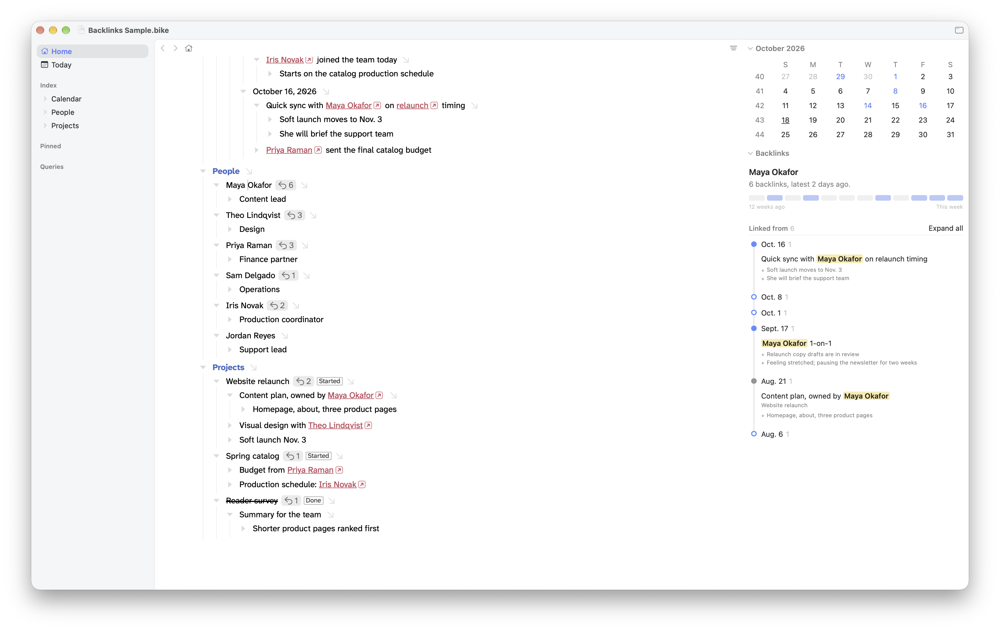

# Backlinks for Bike

An inspector extension for [Bike 2](https://www.hogbaysoftware.com/bike/) that shows what links to the row you're on, as a dated thread.

Bike's row links go one way. Link a daily note to a project, and the project row has no idea. Backlinks closes that loop. Park on any row and the inspector shows every note that points to it, when and what was said.



## Features

- **The thread.** Backlinks hang on a timeline under date circles, newest first. Click a circle or its date to collapse or expand it, or use Expand all and Collapse all.
- **Dates.** Notes under a calendar day page use that day. Everything else uses the row's created date, so turn on Bike's row created-date setting for the best results. Rows with no date land under Undated.
- **Highlighted links.** The link inside each note is marked, so you can see why it's there.
- **Notes up front.** The first rows under each backlink show right away, with "Show more" for the rest.
- **Activity strip.** Twelve cells, one per week, show how often the row was linked recently. Click the start label to switch between "12 weeks ago," "3 months ago" and the start date.
- **Links to.** Where the row points, including links in notes inside it.
- **Linked inside.** A parent row, like a list of people or projects, shows which rows inside it are linked most, with a bar for each.
- **Hover actions.** Open, Focus (zoom Bike into the linking row) and Copy Link.
- **Back.** Every jump from the inspector adds a step, and the Back button walks them in reverse.
- **Count badges.** An arrow and count on rows with backlinks. Click one for a menu of linking rows. Turn them off with "Backlinks: Toggle Count Badges."
- **Keyboard.** "Backlinks: Go to Backlink" opens a searchable list.

## Install

1. Download `backlinks.bkext.zip` from the [latest release](../../releases/latest) and unzip it.
2. Quit Bike. If you have an older Backlinks installed, remove it from Bike's Extensions folder first (Settings › Extensions has a button that reveals the folder).
3. Copy `backlinks.bkext` into the Extensions folder and reopen Bike.

Requires Bike 2 with extension API 0.73 or later.

To try it before using your own outline, open [`sample/Backlinks Sample.bike`](sample/) in Bike, save it once, and click Maya Okafor.

## How it works

- **Links are the whole contract.** Only Bike's own row links count, the kind made with Edit › Copy › Copy Row Link or Format › Add Link to Row…. No tags, attributes or naming conventions.
- **Read-only.** It never writes to your file and never creates row IDs, so Copy Link is unavailable for rows that don't have one yet.
- **Same file only.** Links from other documents, web links and self-links are ignored. A row that links to the same place twice counts once.

## Known limits

- Badges look up counts by row ID. Calendar day IDs like `2026/10/01` repeat across files, so with two outlines open, a day row could show the other file's count.
- Extensions can't choose their position in the inspector, or their order among other extensions' badges.

## Build from source

```sh
npm install
npx bike-ext build --install   # build and install into Bike
npx bike-ext test              # run the tests inside Bike
```

The built extension lands in `out/extensions/backlinks.bkext`. See the [Bike extension kit](https://github.com/bike-outliner/extension-kit) for details.

## Changes

See [CHANGELOG.md](CHANGELOG.md).

## Credits

Built with Claude. I designed and tested it; Claude wrote the code.

## License

[MIT](LICENSE)
